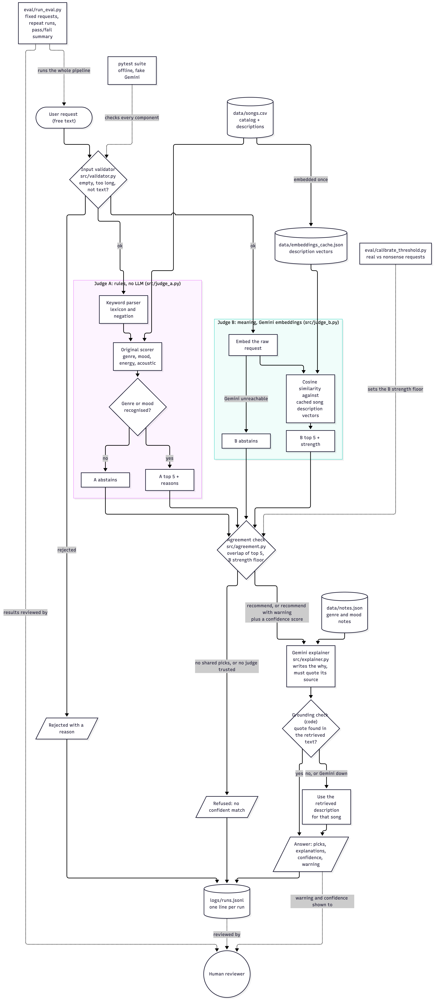

# TasteMatch 2.0: Music Search That Checks Itself

## Base project

This project is built on my Module 3 project, the **Music Recommender Simulation** (TasteMatch 1.0). Original repo: https://github.com/AnishBashyal/ai110-module3show-musicrecommendersimulation-starter

The original was a small content based music recommender. It read 18 songs from a csv file and compared each one to a user profile (favorite genre, favorite mood, target energy, and if they like acoustic songs). Each song got points: genre match +2.0, mood match +1.0, energy closeness up to +1.0, and acousticness up to +0.5. It showed the top 5 songs and a reason for every point. It only worked if the user's genre and mood matched the csv words exactly.

## What this version does

Now you can just type what you want in normal words, like "mellow music for studying late at night", and the system gives you songs with a short explanation and a confidence score.

Two judges look at your request separately:

- **Judge A** is my original scorer. A keyword parser turns your words into a profile, then the old scoring rules rank the songs. No AI model is used here.
- **Judge B** uses Gemini embeddings. It compares the meaning of your request to a short description of each song. This is the retrieval part (RAG).

Then the system checks if they agree. If they agree, the confidence is high. If they only partly agree, or only one judge understood the request, it still answers but shows a warning. If nothing is trusted (like random letters), it refuses. Gemini then writes a short reason for each song using only the retrieved descriptions and notes, and the code checks that the reason really quotes that text.

## Why it matters

Most recommenders always give you something, even when your request makes no sense. I wanted one that can say "I'm not sure" or "I don't understand this", and shows why it picked each song.

## Architecture overview



The diagram is written as text in [diagrams/architecture.mmd](diagrams/architecture.mmd) (Mermaid), and the picture above is made from it. Here is how a request moves through the system:

1. **Input validator** (`src/validator.py`). It cleans the text and rejects things that can't be a music request: empty, too long (over 200 characters), or just numbers and symbols.
2. **Judge A** (`src/judge_a.py`). A keyword parser (`src/text_parser.py`) finds genre, mood, energy and acoustic words, including simple "not sad" handling. Then my original scoring rules rank the songs. If it finds no genre and no mood, Judge A says "no opinion" instead of ranking.
3. **Judge B** (`src/judge_b.py`). It turns the request into an embedding with Gemini and compares it to the saved embeddings of the song descriptions (`data/embeddings_cache.json`). The closest songs win. It also gives a "strength" number, how far the best match is above the average song.
4. **Agreement check** (`src/agreement.py`). It compares the top 5 of both judges. 2 or more shared songs means recommend. 1 shared song means recommend with a warning. If only one judge has an opinion, it answers with a warning and a capped confidence. If nothing is trusted, it refuses.
5. **Explainer** (`src/explainer.py`). Gemini writes one short reason per song using only that song's description and the notes for its genre and mood (`data/notes.json`). It also has to quote its source.
6. **Grounding check.** The code checks that the quote is really in the retrieved text. If not, or if Gemini is down, that song shows its plain description instead.
7. **Run log** (`logs/runs.jsonl`). Every run adds one line, including rejected and refused ones.

Where checking happens:

- **Tests:** a pytest suite that runs offline with a fake Gemini, and an evaluation script (`eval/run_eval.py`) that runs fixed requests through the whole system.
- **Human:** the answer shows the confidence and any warning, and the run log can be read afterwards to see what each judge picked and why.

## Setup instructions

I tested these steps in a fresh clone of this repo (Python 3.14, macOS).

1. **Clone the repo**

   ```bash
   git clone https://github.com/AnishBashyal/applied-ai-system-final.git
   cd applied-ai-system-final
   ```

2. **Make a virtual environment and install the packages**

   ```bash
   python3 -m venv .venv
   source .venv/bin/activate      # Mac or Linux
   .venv\Scripts\activate         # Windows
   pip install -r requirements.txt
   ```

3. **Add your Gemini API key** (needed for Judge B and the explanations). Get a free key at https://aistudio.google.com (Get API key), then:

   ```bash
   cp .env.example .env
   ```

   Open `.env` and replace `your_key_here` with your key. The `.env` file is in `.gitignore`, so it never gets committed.

4. **Run the app**

   ```bash
   python -m src.main --query "mellow music for studying late at night"
   ```

   Running `python -m src.main` with no `--query` still shows my original demo (top 5 for 6 test profiles).

5. **Run the tests** (they work offline with a fake Gemini, no key needed)

   ```bash
   pytest
   ```

6. **Run the evaluation script** (needs the key, takes about a minute)

   ```bash
   python -m eval.run_eval
   ```

   It prints a pass/fail table. Every run of the app also adds a line to `logs/runs.jsonl`.

**If you have no key:** the app still works, but only Judge A answers. The answer comes with a warning and a lower confidence, and vibe requests with no keywords (like "cozy rainy afternoon") are refused. The tests all pass without a key.

**Notes:** the song embeddings are already saved in `data/embeddings_cache.json`, so nothing big is downloaded. Each request makes about 2 small Gemini calls (one embedding, one explanation). If you change a song description, the cache rebuilds that one song on the next run.

## Sample interactions

These are real runs, copied from [logs/evidence/sample_interactions.txt](logs/evidence/sample_interactions.txt). The songs picked are always the same for the same request, but Gemini's wording of the explanations changes a little each time.

### 1. Both judges agree

I type a normal request. Judge A understands "mellow", "studying" and "late at night", and Judge B finds the same kind of songs by meaning. They share 3 of their top 5 songs, so the system recommends them with confidence 0.60.

```
$ python -m src.main --query "mellow music for studying late at night"
Request:    mellow music for studying late at night
Status:     OK   (confidence 0.60)
Decision:   both judges agree on 3 of 5 picks

1. Library Rain - Paper Lanterns
   It features quiet acoustic lofi and gentle rain sounds that create a calm atmosphere perfect for studying.

2. Midnight Coding - LoRoom
   It provides mellow lofi beats with soft keys that are specifically made for late night studying.

3. Spacewalk Thoughts - Orbit Bloom
   It offers slow floating ambient textures that help you drift into deep concentration.

4. Late Bus Home - Blockhead Sam
   It delivers laid back hip hop with dusty drums and mellow samples for a relaxed night ride.

5. Focus Flow - LoRoom
   It features steady minimal lofi without vocals to help you concentrate during deep work.
```

### 2. Fallback when Gemini is down

Here Gemini returned a 503 error (too busy) three times in a row when it was writing the explanations. The system retried, gave up cleanly, and showed each song's own description instead. The picks and confidence are not affected because they don't need Gemini's writing. The warning lines at the top are from the log.

```
$ python -m src.main --query "gym workout rock"
WARNING tastematch.gemini: generate_text attempt 1/3 failed (503)
WARNING tastematch.gemini: generate_text attempt 2/3 failed (503)
WARNING tastematch.gemini: generate_text attempt 3/3 failed (503)
WARNING tastematch.explainer: explainer falling back to retrieved text: generate_text failed after 3 attempts
Request:    gym workout rock
Status:     OK   (confidence 0.80)
Decision:   both judges agree on 4 of 5 picks

1. Backroad Riot - Voltline
   Swaggering rock with big riffs and a cocky attitude that is great for driving with the windows down

2. Storm Runner - Voltline
   Driving rock with heavy guitars and pounding drums that feels like racing through a storm

3. Gym Hero - Max Pulse
   High octane pop with a relentless beat built for workouts and pushing through the last rep

4. Cardio Drop - Max Pulse
   Relentless high tempo electronic beats and hard drops made for running and intense training

5. Garage Fever - Rust Engine
   Fast loud punk with shouted vocals and zero patience that makes you want to break the rules
```

### 3. A request Judge A can't understand

"cozy rainy afternoon" has no genre or mood word that my keyword parser knows, so Judge A says it has no opinion. Judge B still finds songs that fit the meaning (rain, calm, afternoon), so the system answers, but it shows a warning and caps the confidence below 0.5 because only one judge agreed to anything.

```
$ python -m src.main --query "cozy rainy afternoon"
WARNING tastematch.gemini: generate_text attempt 1/3 failed (503)
WARNING tastematch.gemini: generate_text attempt 2/3 failed (503)
Request:    cozy rainy afternoon
Status:     WARNING   (confidence 0.44)
Decision:   only the meaning-based judge had an opinion (no keywords recognised)
Warning:    only one judge had an opinion, so this is less certain

1. Library Rain - Paper Lanterns
   It features quiet acoustic lofi and gentle rain sounds, making it calm and perfect for a cozy rainy afternoon.

2. Coffee Shop Stories - Slow Stereo
   It has smooth brushed drums and warm piano jazz that fits a lazy afternoon.

3. Midnight Coding - LoRoom
   It offers mellow lofi beats with soft keys and vinyl crackle for a chill atmosphere.

4. Focus Flow - LoRoom
   It provides steady minimal lofi with no distracting vocals to help you concentrate.

5. Cotton Cloud Summer - Indigo Parade
   It delivers soft dreamy indie pop with hazy guitars that feels like floating.
```

### 4. Nonsense is refused

"asdf qwerty" is just letters, so it passes the input check. Judge A has no opinion, and Judge B's best match is not clearly better than the average song, so the system refuses instead of guessing.

```
$ python -m src.main --query "asdf qwerty"
Request:    asdf qwerty
Status:     REFUSED   (confidence 0.00)
Decision:   no confident match: the request could not be understood
```

### 5. Bad input is rejected

An empty request is stopped by the input validator before any judge or Gemini is called.

```
$ python -m src.main --query ""
WARNING tastematch.validator: input rejected: request is empty
Request:    
Status:     REJECTED   (confidence 0.00)
Decision:   request is empty
```
